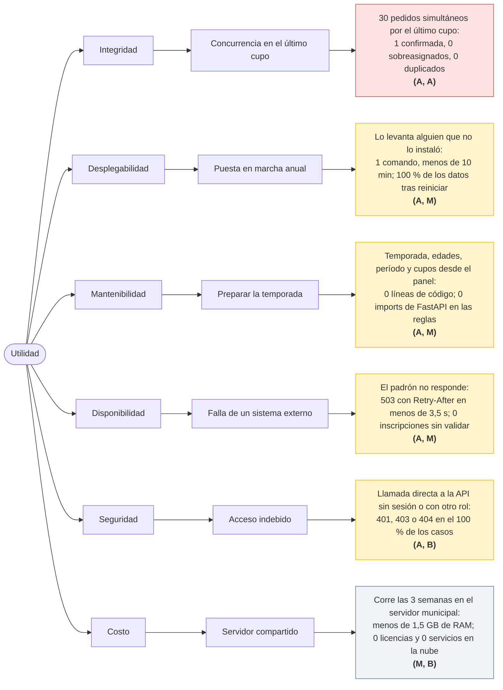
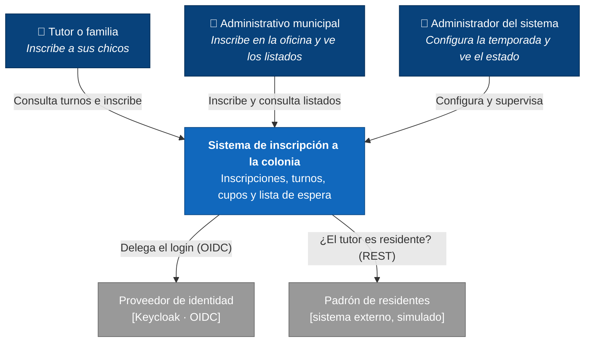
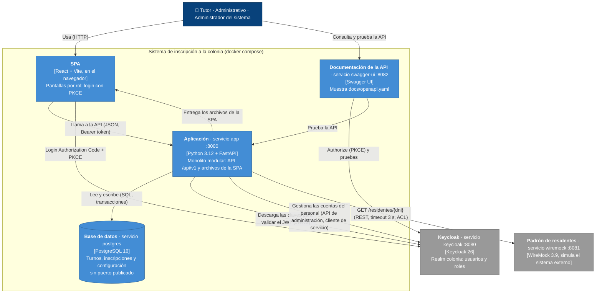
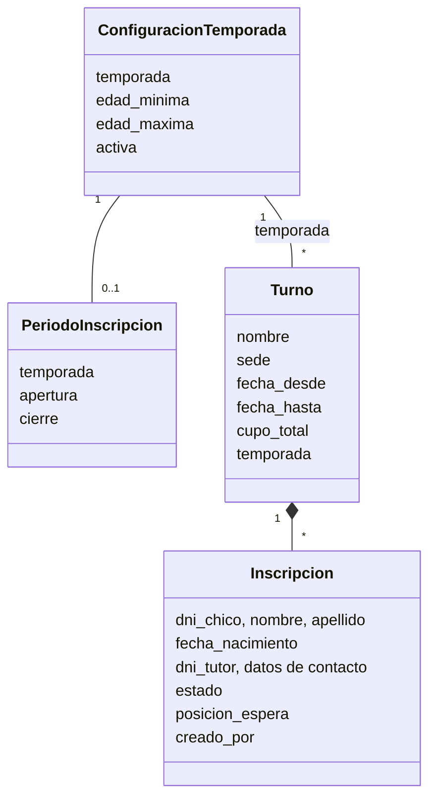
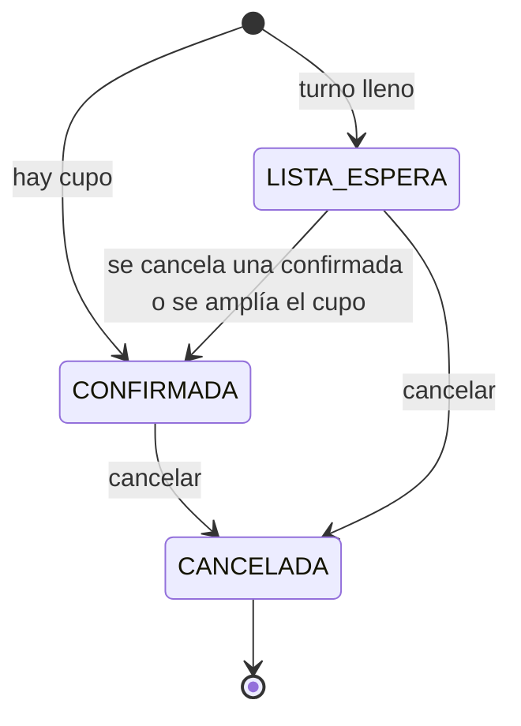

# Documento de arquitectura · TP 6A · Colonia de vacaciones · Municipio chico

Arquitectura de Software 1 · UNAHUR · 2do cuatrimestre 2026 · Grupo Los Betos

Reúne la Entrega 1 (dominio, escenario, requisitos y C4 de Contexto) y la Entrega 2 (Pugh, estilo, C4 de
Contenedores, dominio, API y despliegue), actualizadas con lo implementado y con lo visto en la Clase 13.
Las decisiones están en [docs/adr](adr) y la verificación de los NFRs, en [VERIFICACION.md](VERIFICACION.md).

**Índice:** 1. Dominio · 2. Escenario · 3. Actores y sistemas externos · 4. NFRs escritos como escenarios ·
5. Requisitos funcionales · 6. Matriz de Pugh · 7. Estilo · 8. C4 de Contexto · 9. C4 de Contenedores ·
10. Modelo de dominio · 11. API · 12. Despliegue · 13. Decisiones (ADRs) · 14. Verificación ·
15. Evaluación liviana: riesgos y trade-offs

## 1. Dominio

Gestión de inscripciones a una actividad municipal: la colonia de vacaciones de verano para chicos de 6 a
12 años. El municipio la ofrece gratis y con cupos limitados, y necesita registrar las inscripciones,
organizar los turnos y controlar las vacantes. Las familias inscriben a los chicos por su cuenta o en la
oficina, con ayuda de un administrativo.

Reglas de negocio:

| Regla | Detalle |
|---|---|
| Edad | Entre 6 y 12 años al 1 de enero de la temporada (el rango se configura por temporada) |
| Residencia | Solo tutores con domicilio en la jurisdicción, según el padrón de residentes (sistema externo) |
| Cupo | Cada turno tiene un cupo; nunca puede haber más inscripciones confirmadas que cupos |
| Orden de llegada | Los cupos se asignan en el orden en que llegan los pedidos; los que llegan con el turno lleno quedan en lista de espera, en orden |
| Inscripción única | Un chico no puede tener más de una inscripción activa (confirmada o en espera) en la temporada; si se cancela, puede volver a inscribirse |

## 2. Escenario

| Aspecto | Valor |
|---|---|
| Casillero | 6A · Colonia de vacaciones · Municipio chico |
| Escala | 600 cupos en total para unas 1.500 familias; la inscripción está abierta 3 semanas por año |
| Cómo se inscriben | Muchas familias van a la oficina y las inscribe un administrativo |
| Quién lo mantiene | Un área de sistemas de una sola persona |
| Infraestructura | Un servidor municipal compartido con otros sistemas |
| NFR estrella | Mantenibilidad y costo |
| Restricción | Se usa 3 semanas al año: al año siguiente se tiene que volver a levantar sin que nadie se acuerde de cómo |

Estas características condicionan las decisiones: no hace falta una solución para escala masiva, sino una
que se pueda mantener fácilmente, aproveche los recursos existentes y tenga poca complejidad operativa.

## 3. Actores y sistemas externos

| Elemento | Tipo | Relación con el sistema |
|---|---|---|
| Tutor o familia | Persona | Consulta turnos, inscribe a sus chicos, ve y cancela sus inscripciones |
| Administrativo municipal | Persona | Inscribe en nombre de una familia, ve todas las inscripciones y las listas, cancela |
| Administrador del sistema | Persona | Configura la temporada, las edades, el período de inscripción y el reparto de cupos; da de alta, de baja y cambia el rol de las cuentas del personal municipal; ve el estado de los servicios |
| Proveedor de identidad (Keycloak) | Sistema externo | Autentica con OpenID Connect y entrega los roles; la aplicación comprueba los permisos de cada operación. Guarda las cuentas: la app gestiona las del personal a través de su API de administración |
| Padrón de residentes | Sistema externo (simulado con WireMock) | Responde si un DNI tiene domicilio en la jurisdicción. Se consulta por REST sincrónico, con timeout de 3 s, a través de una capa anticorrupción. Si no responde, la inscripción devuelve 503 y no se crea |

## 4. NFRs escritos como escenarios

Cada NFR se escribe como un escenario de calidad (Bass, Clements y Kazman): *cuando [fuente] hace
[estímulo] sobre [artefacto] en [entorno], el sistema [respuesta], medido como [medida]*. Así se puede
verificar; la prueba y el resultado de cada uno están en [VERIFICACION.md](VERIFICACION.md).

| NFR | Fuente | Estímulo | Artefacto | Entorno | Respuesta | Medida |
|---|---|---|---|---|---|---|
| **NFR-01 Mantenibilidad** (estrella) | La persona de sistemas, que no escribió el código | Tiene que preparar la temporada siguiente o cambiar una regla | Módulo de inscripciones y configuración | Entre temporadas, con el sistema instalado | Hace el cambio en un solo lugar, sin tocar HTTP ni la base | Temporada, edades, período y cupos se cambian desde el panel con 0 líneas de código; las reglas viven en un solo archivo y 0 dependencias del framework web en reglas y repositorios |
| **NFR-02 Costo** | El municipio | Corre el sistema durante la inscripción | Los 5 contenedores | Servidor municipal compartido | Funciona sin infraestructura nueva | Menos de 1,5 GB de RAM en total; 0 licencias pagas y 0 servicios en la nube |
| **NFR-03 Desplegabilidad y recuperación** | Alguien que no instaló el sistema | Lo pone en marcha al año siguiente, o después de un corte | Repositorio y `docker-compose.yml` | Una máquina con Docker, sin nada más | Queda funcionando con la base migrada, los turnos y los usuarios | 1 comando y menos de 10 min en una máquina limpia; 100 % de las inscripciones conservadas después de reiniciar |
| **NFR-04 Integridad y equidad** | 30 familias y administrativos | Piden el último cupo de un turno al mismo tiempo | Inscripciones + PostgreSQL | Pico de apertura de la inscripción | Uno queda confirmado y el resto en lista de espera, en orden de llegada | 1 confirmada, 0 cupos sobreasignados y 0 chicos duplicados en el 100 % de las corridas |
| **NFR-05 Seguridad** | Un usuario sin sesión o con un rol que no corresponde | Llama a una operación protegida directo a la API, sin pasar por la SPA | API | Operación normal | La rechaza en Problem Details y no revela datos ajenos | 100 % de los intentos rechazados con 401, 403 o 404 según el caso |
| **NFR-06 Disponibilidad** | El padrón de residentes | No responde (caído o con error) | Capa anticorrupción del padrón | Durante la inscripción | Responde 503 con `Retry-After` sin crear la inscripción; el resto del sistema sigue atendiendo y el health indica qué falla | Respuesta en menos de 3,5 s (timeout de 3 s) y 0 inscripciones creadas sin validar la residencia |

### Utility tree

Árbol de utilidad de ATAM (Clase 13): de la utilidad del sistema a cada atributo de calidad, un
refinamiento y un escenario concreto con medida. Cada hoja lleva su prioridad (importancia para el
negocio, dificultad técnica), con A alta, M media y B baja. El escenario completo, con sus seis partes,
está en la tabla de arriba.



| Atributo | Refinamiento | Escenario (estímulo → respuesta y medida) | NFR | Prioridad |
|---|---|---|---|---|
| Integridad | Concurrencia en el último cupo | 30 familias y administrativos piden el último cupo a la vez → 1 confirmada y el resto en espera, en orden; 0 sobreasignados, 0 duplicados | NFR-04 | (A, A) |
| Desplegabilidad | Puesta en marcha anual | Alguien que no lo instaló lo levanta al año siguiente → 1 comando, menos de 10 min; 100 % de los datos tras reiniciar | NFR-03 | (A, M) |
| Mantenibilidad | Preparar la temporada | La persona de sistemas cambia temporada, edades, período y cupos → desde el panel, sin tocar código; 0 imports de FastAPI en las reglas | NFR-01 | (A, M) |
| Disponibilidad | Falla de un sistema externo | El padrón no responde durante la inscripción → 503 con `Retry-After` en menos de 3,5 s; 0 inscripciones sin validar | NFR-06 | (A, M) |
| Seguridad | Acceso indebido | Un usuario sin sesión o con otro rol llama directo a la API → 401, 403 o 404 en el 100 % de los casos | NFR-05 | (A, B) |
| Costo | Servidor compartido | El sistema corre las 3 semanas en el servidor municipal → menos de 1,5 GB de RAM; 0 licencias y 0 servicios en la nube | NFR-02 | (M, B) |

## 5. Requisitos funcionales

| ID | Requisito |
|---|---|
| RF-01 | Autenticar a los usuarios con un proveedor de identidad (OIDC) |
| RF-02 | Distinguir los roles tutor, administrativo y administrador del sistema |
| RF-03 | Consultar los turnos de la temporada y sus cupos disponibles |
| RF-04 | Inscribir a un chico en un turno (el tutor o un administrativo en su nombre) |
| RF-05 | Validar que el chico tenga la edad admitida al inicio de la temporada |
| RF-06 | Verificar la residencia del tutor contra el padrón municipal |
| RF-07 | Impedir que un chico tenga más de una inscripción activa en la temporada |
| RF-08 | Impedir que las inscripciones confirmadas superen el cupo del turno, aun con pedidos simultáneos |
| RF-09 | Registrar en lista de espera, con su posición, los pedidos que llegan con el turno lleno |
| RF-10 | Cancelar una inscripción; si estaba confirmada, promover a la primera de la lista de espera |
| RF-11 | Permitir reinscribir a un chico cuya inscripción fue cancelada |
| RF-12 | Que el administrativo consulte todas las inscripciones y los listados |
| RF-13 | Que el administrador del sistema configure la temporada, las edades, el período de inscripción y la distribución de cupos, y consulte el estado de los servicios |
| RF-14 | Si el padrón no responde, devolver 503 y no confirmar la inscripción |
| RF-15 | Que el administrador del sistema registre cuentas del personal municipal (administrativos y administradores del sistema), las dé de baja o las reactive y les cambie el rol |

## 6. Matriz de Pugh

Baseline: monolito por capas. Escala relativa al baseline: +1 mejor, 0 igual, −1 peor para este escenario.
Los criterios son los seis NFRs.

| Criterio | Monolito por capas (baseline) | Monolito modular | Microservicios | Orientada a eventos |
|---|---|---|---|---|
| NFR-01 Mantenibilidad | 0 | +1 | +1 | 0 |
| NFR-02 Costo | 0 | +1 | −1 | −1 |
| NFR-03 Desplegabilidad y recuperación | 0 | +1 | −1 | −1 |
| NFR-04 Integridad y consistencia | 0 | +1 | −1 | −1 |
| NFR-05 Seguridad | 0 | 0 | 0 | 0 |
| NFR-06 Disponibilidad | 0 | 0 | +1 | +1 |
| **Total** | **0** | **+4** | **−1** | **−2** |

- **Mantenibilidad:** el monolito modular es una sola aplicación con módulos separados por responsabilidad.
  Microservicios también aíslan responsabilidades, pero con mucha más operación para una sola persona.
- **Costo:** el monolito modular aprovecha el servidor compartido y no suma infraestructura distribuida.
- **Desplegabilidad:** una aplicación y sus dependencias se levantan con un comando al comienzo de cada temporada.
- **Integridad:** una sola base PostgreSQL permite resolver el cupo y la inscripción única con transacciones locales.
- **Seguridad:** todas pueden usar OIDC y roles; no diferencia.
- **Disponibilidad:** microservicios y eventos aíslan mejor las fallas, pero el escenario no pide alta disponibilidad.

Resultado: el **monolito modular** da el mejor equilibrio para las restricciones del escenario.

## 7. Estilo

**Monolito modular con Clean Architecture liviana** ([ADR-001](adr/001-monolito-modular.md),
[ADR-002](adr/002-clean-liviana.md)). Una sola unidad de despliegue y una sola base PostgreSQL; por dentro,
módulos `turnos`, `inscripciones` y `administracion`, cada uno con dependencias en un solo sentido:

```text
routes.py (HTTP)  →  service.py (casos de uso y reglas)  →  repository.py / integrations (datos y padrón)
```

Las reglas viven en `service.py`, que no conoce HTTP; los errores de negocio son excepciones del dominio
que un manejador único traduce a Problem Details. Configuración, base, seguridad e integración con el
padrón son piezas transversales (`app/core`, `app/integrations`).

## 8. C4 · Diagrama de Contexto (nivel 1)



## 9. C4 · Diagrama de Contenedores (nivel 2)

Coincide con `docker-compose.yml`: cinco servicios (`app`, `postgres`, `keycloak`, `wiremock`,
`swagger-ui`). La SPA es un contenedor lógico que corre en el navegador pero se sirve desde `app`.
En el TP todo va por HTTP; en producción, HTTPS lo pone el proxy del municipio.



| Contenedor | Tecnología | Responsabilidad | Puerto |
|---|---|---|---|
| Aplicación (`app`) | Python 3.12 + FastAPI | API `/api/v1` con los módulos del monolito; sirve la SPA compilada; aplica migraciones y datos iniciales al arrancar | 8000 |
| SPA | React + Vite (en el navegador) | Interfaz por rol; login con Keycloak (PKCE) | servida por `app` |
| Base de datos (`postgres`) | PostgreSQL 16.4 | Persiste turnos, inscripciones y configuración; bloqueo de fila para el cupo | ninguno (solo red interna) |
| Proveedor de identidad (`keycloak`) | Keycloak 26.0 | Autentica, emite los tokens con los roles y guarda las cuentas; realm versionado en `keycloak/`. La app lo usa además como cliente de servicio (`colonia-admin-api`) para gestionar las cuentas del personal | 8080 |
| Padrón (`wiremock`) | WireMock 3.9.1 | Simula el padrón de residentes (residente, no residente y caído) | 8081 |
| Documentación (`swagger-ui`) | Swagger UI 5.17 | Muestra el contrato `docs/openapi.yaml` y permite probar la API con login | 8082 |

El compose tiene además un servicio `verificador` en el perfil `verificacion`: no forma parte del sistema
y solo se usa para correr las pruebas de [VERIFICACION.md](VERIFICACION.md).

## 10. Modelo de dominio

Caso de uso principal: *un tutor (o un administrativo en su nombre) inscribe a un chico en un turno de la
temporada vigente*.



- **Agregado raíz: Turno.** Protege la invariante del cupo: toda inscripción, cancelación o cambio de cupo
  bloquea primero la fila del turno (`SELECT … FOR UPDATE`), así que las decisiones sobre un turno se
  toman de a una ([ADR-003](adr/003-cupo-postgresql-bloqueo.md)).
- **Invariantes:** inscripciones confirmadas ≤ `cupo_total`; un solo registro activo por
  (`dni_chico`, `temporada`), garantizado además por un índice único parcial que excluye las canceladas;
  posiciones de espera consecutivas dentro de cada turno.
- **Estados de una inscripción:**



Flujo de una inscripción por las capas: `routes.py` recibe el pedido y comprueba el rol → `service.py`
valida la edad y consulta el padrón (ACL) → bloquea el turno, revisa duplicados, cuenta confirmadas y
decide CONFIRMADA o LISTA_ESPERA → `repository.py` guarda → 201 con `Location`.

## 11. API

Contract-first: el contrato es [openapi.yaml](openapi.yaml) y se ve
en Swagger UI (http://localhost:8082). Versión en la ruta (`/api/v1`) y errores con Problem Details
(RFC 9457).

| Método | Ruta | Roles | Para qué |
|---|---|---|---|
| GET | `/api/v1/health` | público | Estado de la API, la base, Keycloak y el padrón (503 si alguno falla) |
| GET | `/api/v1/config` | público | Configuración que necesita la SPA para el login |
| GET | `/api/v1/system-info` | administrador del sistema | Información técnica y estado de los servicios |
| GET | `/api/v1/turnos` | cualquiera autenticado | Turnos de la temporada con sus cupos disponibles |
| GET | `/api/v1/periodo-inscripcion` | los tres | Si la inscripción está abierta |
| GET | `/api/v1/temporada` | los tres | Temporada activa y edades admitidas (las muestra el inicio) |
| POST | `/api/v1/inscripciones` | los tres | Inscribir (201 + `Location`; 409, 422, 503) |
| GET | `/api/v1/inscripciones/{id}` | cualquiera autenticado | Ver una inscripción (el tutor, solo las suyas: 404 si no) |
| POST | `/api/v1/inscripciones/{id}/cancelar` | los tres (el tutor, solo las suyas) | Cancelar y promover a la primera en espera |
| GET | `/api/v1/mis-inscripciones` | cualquiera autenticado | Las inscripciones que cargó el usuario |
| GET | `/api/v1/admin/inscripciones` | administrativo, administrador del sistema | Todas las inscripciones de la temporada |
| GET / PUT | `/api/v1/admin/periodo-inscripcion` | administrador del sistema | Apertura y cierre de la inscripción |
| GET / PUT | `/api/v1/admin/configuracion-temporada` | administrador del sistema | Temporada activa y rango de edades |
| PUT | `/api/v1/admin/distribucion-cupos` | administrador del sistema | Repartir los 600 cupos entre los turnos (promueve si un turno gana cupos) |
| GET / POST | `/api/v1/admin/usuarios` | administrador del sistema | Listar y registrar cuentas del personal (201 + `Location`; 409 si el usuario ya existe) |
| GET / PUT | `/api/v1/admin/usuarios/{id}` | administrador del sistema | Ver y modificar una cuenta: datos, rol, baja o reactivación (409 si el cambio dejaría al sistema sin administradores) |

## 12. Despliegue

Todo se levanta con `docker compose up -d --build` ([ADR-006](adr/006-docker-compose.md)): imágenes con
versión fija, valores por defecto para todas las variables (no hace falta `.env`), migraciones y datos
iniciales automáticos, realm de Keycloak importado al arrancar, la base sin puerto publicado y la app
corriendo con un usuario sin privilegios. URLs y usuarios de prueba en el [README](../README.md).

## 13. Decisiones (ADRs)

Formato: **MADR 4** (contexto y problema, drivers, opciones consideradas, resultado con consecuencias
buenas y malas, confirmación, y pros y contras de cada opción). Un ADR aceptado no se edita: se reemplaza
por otro.

| ADR | Decisión | NFR principal | Estado |
|---|---|---|---|
| [001](adr/001-monolito-modular.md) | Monolito modular | Mantenibilidad, costo | Aceptada |
| [002](adr/002-clean-liviana.md) | Clean Architecture liviana | Mantenibilidad | Aceptada |
| [003](adr/003-cupo-postgresql-bloqueo.md) | Base relacional con transacción y bloqueo de fila para el cupo | Integridad y equidad | Aceptada |
| [004](adr/004-padron-rest-sincronico-acl.md) | Padrón por REST sincrónico con capa anticorrupción | Consistencia, disponibilidad | Aceptada |
| [005](adr/005-keycloak-oidc-pkce.md) | Keycloak con OIDC, Authorization Code + PKCE | Seguridad | Aceptada |
| [006](adr/006-docker-compose.md) | Despliegue con Docker Compose, versiones fijas y valores por defecto | Desplegabilidad, costo | Aceptada |

Plantilla para nuevas decisiones: [000-plantilla.md](adr/000-plantilla.md).

## 14. Verificación de NFRs

Qué se verificó, cómo y con qué resultado: [VERIFICACION.md](VERIFICACION.md). Las pruebas corren con
`docker compose --profile verificacion run --rm verificador` y dejan su evidencia en
`verificacion/resultados/`.

## 15. Evaluación liviana: riesgos y trade-offs

Evaluación al estilo ATAM (Clase 13) sobre los escenarios de mayor prioridad del utility tree, recorridos
sobre el C4 de Contenedores. Cada riesgo termina en un ADR, una verificación o un «lo aceptamos».

| Escenario | Decisión que lo sostiene | Sensibilidad | Trade-off | Riesgo | Qué hacemos |
|---|---|---|---|---|---|
| NFR-04 último cupo (A, A) | Bloqueo de fila del turno (ADR-003) | La equidad depende por completo del bloqueo y de que toda escritura sobre el turno lo use | Consistencia a cambio de capacidad: los pedidos al mismo turno se atienden de a uno | Si el pico fuera mucho mayor, la escritura escala solo en vertical | Lo aceptamos para 1.500 familias; se verifica con 30 pedidos simultáneos. Táctica si creciera: una cola delante |
| NFR-06 padrón caído (A, M) | REST sincrónico con ACL y timeout (ADR-004) | La disponibilidad de la inscripción depende de la del padrón | Regla siempre aplicada y respuesta inmediata, a costa de disponibilidad | Si el padrón se cae en la apertura, nadie se puede inscribir | Lo aceptamos: 503 con `Retry-After`, nadie pierde el lugar ya asignado y la inscripción dura 3 semanas. Verificado con el padrón detenido |
| NFR-03 volver a levantarlo (A, M) | Compose con versiones fijas y valores por defecto (ADR-006) | Depende de que las imágenes sigan disponibles en los registros públicos | Reproducibilidad a cambio de no recibir parches solos | Una imagen con vulnerabilidades conocidas un año después; Keycloak en `start-dev` pierde los usuarios creados a mano | Actualizar las versiones a propósito antes de cada temporada; para producción, volumen o base para Keycloak y modo `start` (ADR-005) |
| NFR-01 preparar la temporada (A, M) | Configuración de temporada desde el panel y reglas en `service.py` (ADR-002) | Depende de que nadie saltee las capas | Simplicidad a cambio de atar el dominio a SQLAlchemy | Erosión: que la regla de dependencias se rompa sin que nadie lo note | Fitness function de arquitectura en la verificación |
| NFR-05 gestión de cuentas del personal (A, B) | Cliente de servicio con permisos mínimos sobre Keycloak (ADR-005) | Depende de que nadie más tenga el secreto del cliente de servicio | Administrar cuentas desde el panel, a costa de una credencial con permiso para gestionar usuarios | Si la app quedara comprometida, se podrían gestionar cuentas del realm | La app solo gestiona los dos roles del personal; secreto en el `.env`; nunca queda el sistema sin administradores |
| NFR-05 acceso directo a la API (A, B) | Validación del JWT y `require_roles` en cada operación (ADR-005) | Depende de validar firma, emisor, audiencia y vencimiento en el backend | — | El período de inscripción hoy lo controla solo la SPA: la API acepta inscripciones fuera de fecha si se la llama directo | Mover el control del período al servicio de inscripciones (pendiente) |

**No-riesgos:** la base sin puerto publicado (solo la ve la app); la consulta al padrón antes de bloquear
el turno, que evita retener el bloqueo mientras se espera a un sistema externo; un chico no puede quedar
duplicado aunque dos pedidos lleguen juntos, porque además del control en el código está el índice único
parcial en la base.
